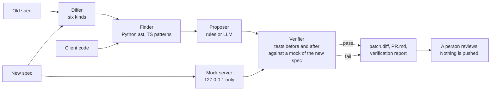

# driftpatch

[](https://github.com/shreyas-tech7/driftpatch/actions/workflows/ci.yml)

<!-- driftpatch:status -->
**Status:** v0.1.0-rc1, a release candidate. The rule baseline fixes 22 of 36 frozen cases with 0 regressions and the suite runs in 58 s on 2 cores. The census covers 36 release pairs of 2 real APIs.
<!-- /driftpatch:status -->

Every number on this page is written by `driftpatch readme` from a file in `results/`. The benchmark uses an invented API, so read the Limits part before you quote a number.

## The problem

You keep a hand-written client for an API you do not own. The API ships a new OpenAPI spec. A field gets renamed, a query parameter becomes required, an endpoint goes away. Diff tools such as oasdiff tell you what changed in the spec. They do not tell you which lines of your client break, and they do not fix them.

driftpatch does the next three steps:

1. It finds the call sites in your client that each breaking change hits (Python with `ast`, TypeScript with patterns).
2. It proposes a patch, with a rule baseline or with a language model.
3. It verifies the patch: it runs your client's own tests against a mock server built from the new spec, before and after the patch. A patch passes only if every test that failed now passes and no test that passed now fails.

It writes a unified diff, a pull request text and a verification report. It never pushes and never opens a pull request. A person reads the diff and decides.

## How it works



The run is a state machine: `DIFF -> FIND -> PROPOSE -> VERIFY -> REPORT -> END`. Each state has a fixed set of next states, and every transition has a test in `tests/test_pipeline.py`.

The six kinds of breaking change are `removed-endpoint`, `renamed-field`, `removed-field`, `new-required-parameter`, `changed-type` and `changed-enum`.

## Results

The suite has frozen cases built from one invented API, Acme Orders, with a Python client and a TypeScript client. Each case is one or two spec changes plus a known correct patch. A SHA-256 manifest stops the run if any case, spec or client file changes. Cases are split into dev and held out by a seeded shuffle.

<!-- driftpatch:results -->
| Proposer | Cases verified | 95% interval | Test pass rate after | 95% interval | Regressions | Median patch lines | Tokens | Held-out verified |
| --- | --- | --- | --- | --- | --- | --- | --- | --- |
| Rule baseline | 22 of 36 | 44.9 to 75.2 | 95.9% | 94.2 to 97.5 | 0 | 2 | 0 | 5 of 11 |
| LLM (replay) | not run | | | | | | | |
| Answer key (sanity check) | 36 of 36 | 90.4 to 100.0 | 100.0% | 100.0 to 100.0 | 0 | 2 | 0 | 11 of 11 |

Run on 2026-11-20, Intel(R) Xeon(R) Processor @ 2.30GHz, Python 3.13.18. Seed: none for the pipeline (deterministic). Bootstrap seed 7, 2000 rounds. Frozen files checked: 117.
<!-- /driftpatch:results -->

"Test pass rate after" is the mean share of the client's tests that pass after the patch. When a proposer declines a case, that case counts with its unpatched pass rate.

The answer key row replays each case's known patch. It is not a proposer. It shows that every case can be solved and that the verifier accepts a correct patch.

The LLM row needs a model call, and no model endpoint could be reached from the build machine. It is marked "not run" instead of filled with guesses. See [BLOCKERS.md](BLOCKERS.md).

Which kinds the rule baseline handles:

<!-- driftpatch:kinds -->
| Change kind | Cases with it | Fixed by the rule baseline |
| --- | --- | --- |
| removed-endpoint | 4 | 0 |
| renamed-field | 15 | 14 |
| removed-field | 5 | 4 |
| new-required-parameter | 7 | 5 |
| changed-type | 5 | 0 |
| changed-enum | 3 | 0 |
<!-- /driftpatch:kinds -->

The rule baseline declines a removed endpoint, a changed type, an enum change and a new required parameter that has no default in the spec. Those need judgment, which is the space an LLM proposer is for.

### Census of real APIs

How often do real APIs ship these changes? driftpatch counted them across sampled releases of two public spec histories. Nothing was cloned. Tags came from `git ls-remote` and each spec from a raw file download.

<!-- driftpatch:census -->
| API | Release pairs | Pairs with a breaking change | removed-endpoint | renamed-field | removed-field | new-required-parameter | changed-type | changed-enum |
| --- | --- | --- | --- | --- | --- | --- | --- | --- |
| stripe/openapi | 19 | 19 | 69 | 37 | 170 | 3 | 2 | 203 |
| github/rest-api-description | 17 | 7 | 67 | 7 | 74 | 20 | 19 | 14 |

Built-in differ counts from 2026-11-20. Method and the oasdiff counts are in [docs/CENSUS.md](docs/CENSUS.md).
<!-- /driftpatch:census -->

## Cost per task

<!-- driftpatch:cost -->
| Proposer | Money per case | Tokens per case | Seconds per case |
| --- | --- | --- | --- |
| Rule baseline | $0 (no model) | 0 | 1.6 |
| LLM (replay) | not run | not run | not run |
| Answer key (sanity check) | $0 (no model) | 0 | 2.1 |

The full rule run took 58.1 s on 2 cores (Intel(R) Xeon(R) Processor @ 2.30GHz) on 2026-11-20, against a limit of 600 s.
<!-- /driftpatch:cost -->

The rule baseline runs locally with no model, so it costs nothing beyond CPU time. Most of the time goes to the client's tests, which the bench runs up to three times per case: once for the unpatched pass rate, then before and after the patch.

## 10-minute run guide

The repo is private for now, so the clone works only for people with access until it goes public. You need Python 3.11 or newer and Node 22 or newer.

```bash
git clone https://github.com/shreyas-tech7/driftpatch.git
cd driftpatch
./init.sh                       # venv, install, ruff, every test offline
source .venv/bin/activate
driftpatch diff examples/acme/specs/acme-orders-v1.json examples/acme/specs/acme-orders-v2.json
driftpatch run examples/acme/specs/acme-orders-v1.json examples/acme/specs/acme-orders-v2.json examples/acme/clients/python
cat out/run/PR.md               # the pull request text
driftpatch bench --proposer rule    # the frozen suite, a few minutes
driftpatch readme --check       # the README matches results/
```

`driftpatch run` writes `out/run/patch.diff`, `out/run/PR.md`, `out/run/verification.md` and `out/run/verification.json`. A real transcript is in [docs/DEMO.md](docs/DEMO.md).

To use it on your own client, point it at your two specs and your client folder. The client's tests must read the API base URL from `ACME_BASE_URL` (the name is fixed for now) so they can hit the mock.

### Optional: oasdiff

If `oasdiff` is on your PATH, `driftpatch diff --engine both` and `driftpatch run --oasdiff` add its findings to the output. The built-in differ still drives the patch, because oasdiff findings do not carry the old and new names a patch needs.

### Optional: an LLM proposer

```bash
export GROQ_API_KEY=...         # any OpenAI-compatible endpoint works with --llm-url and --llm-model
driftpatch bench --proposer llm --llm-mode record
driftpatch bench --proposer llm # replay from fixtures/llm, no network
```

Record mode saves each answer under `fixtures/llm/`, so later runs replay offline.

### Exit codes

| Code | Meaning |
| --- | --- |
| 0 | Success, or a verified patch, or no breaking changes |
| 1 | No patch, a failed verification, or a README that is out of date |
| 2 | A spec or file that cannot be read |

## Limits

- The benchmark uses one invented API and two small clients. It shows that the pipeline works and that the verifier catches bad patches. It does not show how often driftpatch fixes a real client.
- A patch is only as good as the client's tests. A change that no test covers is not caught, and the verifier cannot tell.
- The TypeScript finder uses patterns and a brace scanner, not a parser. It is weaker than the Python finder and is marked experimental.
- The built-in differ skips `allOf`, `oneOf` and `anyOf` schemas, so its census counts are a floor.
- Rename detection is a heuristic: a removed and an added field of the same type with similar names. `x-renamed-from` in the new spec overrides it.
- The mock server answers with the spec's examples. A client that depends on real data or on side effects is not tested.
- The guard covers the driftpatch process itself. It blocks any git command that mentions push and any connection or name lookup that is not loopback or the model host. The client's tests run as child processes outside it, so they can do whatever your test code does. Run a client you do not trust in a sandbox.
- `driftpatch census` is the one command that goes online, and it runs without the guard. Every other command runs under it.
- No LLM numbers yet. See [BLOCKERS.md](BLOCKERS.md).

## Glossary

| Term | Meaning |
| --- | --- |
| Breaking change | A spec change that can make an existing client fail |
| Call site | A place in client code that calls an affected endpoint or reads an affected field |
| Proposer | The part that writes a patch: rules, an LLM, or the answer key |
| Verifier | The part that runs the client's tests before and after a patch against a mock of the new spec |
| Regression | A test that passed before the patch and fails after it |
| Held out | Cases kept aside while the rules were written, used only to report |
| Wilson interval | A 95% interval for a pass rate that stays sensible with few cases |
| Bootstrap interval | A 95% interval found by resampling the cases many times |

## Related work

- [oasdiff](https://github.com/oasdiff/oasdiff) finds breaking changes between two OpenAPI specs. driftpatch can call it and uses its kinds as a reference.
- [openapi-diff](https://github.com/OpenAPITools/openapi-diff) compares two OpenAPI specs and reports changes.
- [Optic](https://github.com/opticdev/optic) checks API changes in CI.
- SDK generators rebuild a whole client from the spec. driftpatch is for clients written by hand, where a rebuild is not an option.

## How this was built

AI agents wrote most of the code under Shreyas's direction. The full build prompt is in [docs/build/BUILD_PROMPT.md](docs/build/BUILD_PROMPT.md). Design choices are in [DECISIONS.md](DECISIONS.md) and failures are in [BLOCKERS.md](BLOCKERS.md).

Human checks, not done yet:

- Shreyas has not yet read the code or the diff.
- Shreyas has not yet rerun `./init.sh` outside the build machine.
- Shreyas has not yet tried driftpatch on a real client.

MIT License. Copyright (c) 2026 Shreyas.
